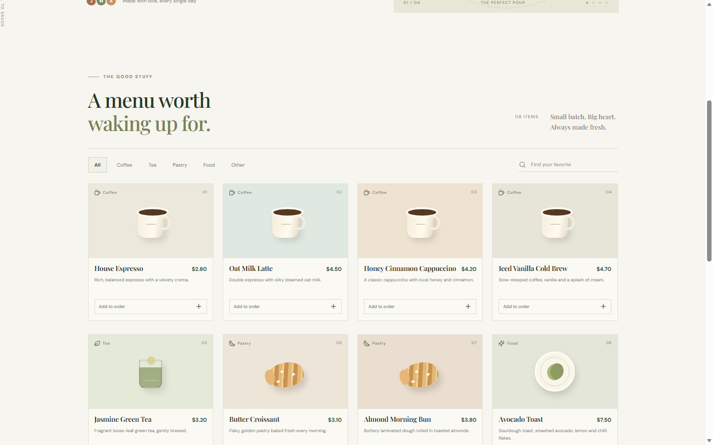
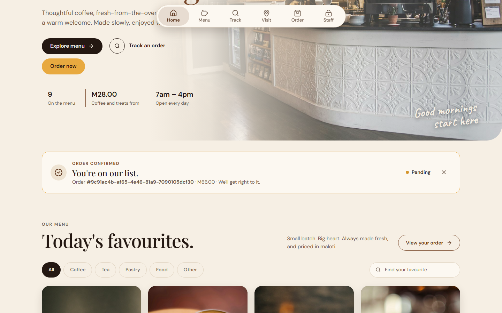
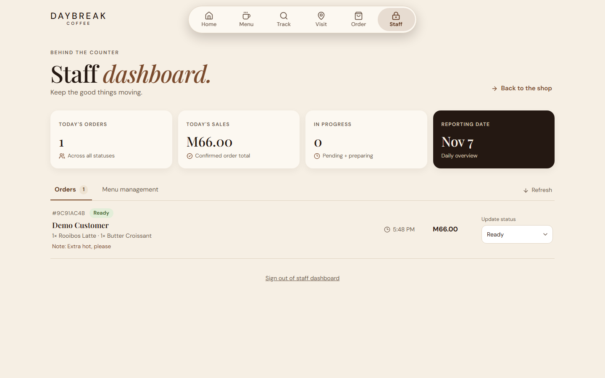
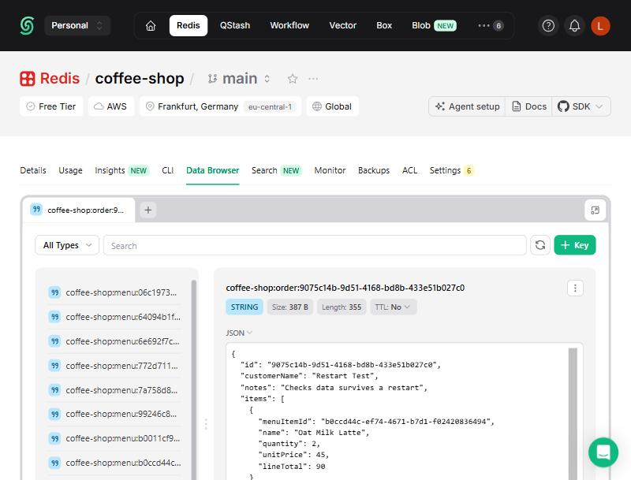
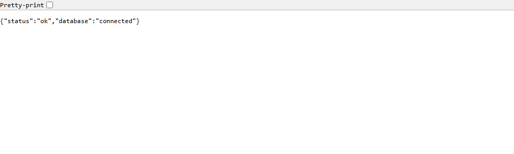

# Coffee Shop Management

A full-stack coffee shop ordering and staff management application. Customers browse the menu and place orders; staff manage the menu and process orders. The React frontend talks to an Express REST API using the Fetch API, and the API stores menu items and orders as JSON values under unique keys in Redis.

BIWA2110 Web Application Development: Group Assignment.

## Live deployment

| Part | URL |
| --- | --- |
| GitHub repository | <https://github.com/lefamoopisalmk-afk/groupassignmen_coffe-managment> |
| React frontend (Netlify) | <https://daybreakcoffee.netlify.app/> |
| Express backend (Render) | <https://coffee-shop-api-ozjb.onrender.com> |
| Backend health check | <https://coffee-shop-api-ozjb.onrender.com/api/health> |

The backend runs on Render's free plan, which sleeps when idle, so the first request after a quiet period can take about a minute. Open the health check first before a demonstration.

## Features

**Customers**

- Browse coffee, tea, pastries and food, with each item's name, description, availability and price in Lesotho maloti (M).
- Filter by category and search by name.
- Add items to a cart and change quantities.
- Place an order with a name and optional notes, then receive a confirmation and unique order number.
- Check an order's current status using its order number.

**Staff** (protected by a bearer token)

- Add, edit and delete menu items, including names, prices and availability.
- View customer orders with items, notes and totals.
- Update order status: Pending, Preparing, Ready, Collected.
- View the daily order count, sales total and orders in progress.

**Data and reliability**

- Records live in Redis and survive API restarts. The API holds no records in memory and never silently falls back to in-memory storage.
- Order totals are calculated on the server from stored prices, never trusted from the browser.
- Requests are validated, and errors use consistent JSON and suitable HTTP status codes.
- CORS is restricted to configured origins, and API requests are rate limited.

## Technologies

| Layer | Technology | Hosting |
| --- | --- | --- |
| Frontend | React 19, TypeScript, Vite, Fetch API, Framer Motion, lucide-react | Netlify |
| Backend | Node.js, Express 5, Zod, cors, express-rate-limit | Render |
| Database | Redis (key-value NoSQL) through the official `redis` client | Upstash |
| Testing | Node.js built-in test runner | |
| Collaboration | Git and GitHub | GitHub |

## Project structure

```text
client/           React frontend
  src/api.ts      All Fetch API calls
  src/App.tsx     Customer interface and staff dashboard
  src/components/ui/floating-nav.tsx  Navigation bar
  public/images/  Photos
server/           Express REST API
  src/app.js      Routes, authentication and error flow
  src/store.js    Redis key-value storage
  src/schemas.js  Request validation
  scripts/        Database record viewer
  test/           API tests
docs/             Demonstration guide and screenshots
render.yaml       Render deployment settings
```

## Data model

Each record is one Redis string holding a JSON value, under a key built from a generated UUID. A Redis set indexes the IDs of each record type.

| Key | Type | Holds |
| --- | --- | --- |
| `coffee-shop:menu:<uuid>` | String (JSON) | One menu item |
| `coffee-shop:order:<uuid>` | String (JSON) | One order, with its line items and total |
| `coffee-shop:menu:ids` | Set | All menu item IDs |
| `coffee-shop:order:ids` | Set | All order IDs |

To print the stored records, set `REDIS_URL` in `server/.env`, then run this from the `server` folder:

```sh
npm run records
```

## Installation

**Requirements:** Node.js 20 or newer, npm 10 or newer, and a Redis 6 or newer database. A free hosted database (see [Deployment](#deployment)) is the easiest choice on Windows, because no local Redis install is needed.

1. Clone the repository and install dependencies:

   ```sh
   git clone https://github.com/lefamoopisalmk-afk/groupassignmen_coffe-managment.git
   cd groupassignmen_coffe-managment
   npm install
   ```

2. Copy `server/.env.example` to `server/.env` and set:

   | Variable | Value |
   | --- | --- |
   | `REDIS_URL` | Your Redis connection URL |
   | `STAFF_API_TOKEN` | A long random secret, used to sign in to the staff dashboard |
   | `CORS_ORIGIN` | `http://localhost:5173` |
   | `PORT` | `3001` |

3. Start the frontend and backend together:

   ```sh
   npm run dev
   ```

4. Open <http://localhost:5173>. The API listens on <http://localhost:3001>.

The sample menu is added automatically the first time the API starts with an empty database.

## API endpoints

| Method | Endpoint | Access | Purpose |
| --- | --- | --- | --- |
| GET | `/api/health` | Public | API and database health (503 if the database is unreachable) |
| GET | `/api/menu` | Public | List menu items |
| GET | `/api/menu/:id` | Public | Read one menu item |
| POST | `/api/menu` | Staff | Add a menu item |
| PUT | `/api/menu/:id` | Staff | Update a menu item |
| DELETE | `/api/menu/:id` | Staff | Delete a menu item |
| POST | `/api/orders` | Public | Place an order |
| GET | `/api/orders` | Staff | List orders, newest first |
| GET | `/api/orders/summary/daily` | Staff | Today's order count, sales and status counts |
| GET | `/api/orders/:id` | Public | Read an order's status |
| PATCH | `/api/orders/:id/status` | Staff | Update an order's status |

Staff requests send `Authorization: Bearer <STAFF_API_TOKEN>`. Public order lookups return only the order number, status, timestamps and total, never customer details.

**Example: place an order**

```http
POST /api/orders
Content-Type: application/json

{
  "customerName": "Sample Customer",
  "notes": "Extra hot, please.",
  "items": [{ "menuItemId": "<menu item uuid>", "quantity": 2 }]
}
```

Response `201 Created`:

```json
{
  "id": "<order uuid>",
  "status": "Pending",
  "total": 9.2,
  "createdAt": "2026-11-05T21:33:00.000Z",
  "updatedAt": "2026-11-05T21:33:00.000Z"
}
```

**Status codes**

| Code | Meaning |
| --- | --- |
| 200, 201, 204 | Success |
| 400 | Invalid data, malformed JSON or an order item that no longer exists |
| 401 | Missing or wrong staff token |
| 404 | Record or route not found |
| 409 | Ordered item is unavailable |
| 429 | Too many requests |
| 500, 503 | Server or database problem |

## Deployment

### 1. Database (Upstash)

The assignment needs a persistent database. Upstash's free Redis plan includes persistence. **Do not use Render's free Key Value instance**, because Render documents that it has no persistence and can lose its data whenever it restarts.

1. Create a Redis database at <https://console.upstash.com>.
2. Copy its TCP connection URL, which starts with `rediss://`. This is `REDIS_URL`, and it contains a password, so never commit it.

### 2. Backend (Render)

1. In Render, choose **New > Blueprint** and connect this repository. `render.yaml` sets the free plan, the `server` root directory, and the build and start commands.
2. Enter `REDIS_URL`. Enter `CORS_ORIGIN` once the frontend URL is known (it can be updated later).
3. Render generates `STAFF_API_TOKEN`. Copy it from the service's **Environment** page: this is the staff dashboard sign-in.
4. Check that `https://<your-api-host>/api/health` returns `{"status":"ok","database":"connected"}`.

### 3. Frontend (Netlify)

1. In Netlify, import this repository and set the base directory to `client`. `client/netlify.toml` sets the build command (`npm run build`) and publish directory (`dist`).
2. Add the environment variable `VITE_API_URL` set to the backend URL, for example `https://<your-api-host>`, with no trailing slash.
3. Deploy, then set the frontend URL as `CORS_ORIGIN` on Render.

`VITE_API_URL` is public configuration. Never put the staff token or Redis credentials in frontend environment variables.

Vercel also works: set the root directory to `client` and add the same variable.

## Tests

```sh
npm test        # API tests
npm run build   # Type-check and build the frontend
```

## Screenshots

See the [demonstration guide](docs/DEMO.md) for the full add-item, place-order and update-status walkthrough.

| Customer menu | Order confirmation | Staff dashboard |
| --- | --- | --- |
|  |  |  |

The menu image is from the live site. The order and staff images use sample data from a local test run.

Stored records in the live Upstash database:



Live backend health check:



## Photo credits

The photos in `client/public/images` are free to use under the [Unsplash License](https://unsplash.com/license).

| File | Source |
| --- | --- |
| `hero-cafe.jpg` | <https://images.unsplash.com/photo-1469631423273-6995642a6a40> |
| `espresso.jpg` | <https://images.unsplash.com/photo-1579992357154-faf4bde95b3d> |
| `oat-latte.jpg` | <https://images.unsplash.com/photo-1760163178873-7644a924519e> |
| `cappuccino.jpg` | <https://images.unsplash.com/photo-1506372023823-741c83b836fe> |
| `cold-brew.jpg` | <https://images.unsplash.com/photo-1461023058943-07fcbe16d735> |
| `green-tea.jpg` | <https://images.unsplash.com/photo-1615227875116-ae28a77814fb> |
| `croissant.jpg` | <https://images.unsplash.com/photo-1681218079567-35aef7c8e7e4> |
| `morning-bun.jpg` | <https://images.unsplash.com/photo-1645995575875-ea6511c9d127> |
| `avocado-toast.jpg` | <https://images.unsplash.com/photo-1783307525039-b92506474dc8> |
| `story-table.jpg` | <https://images.unsplash.com/photo-1558210834-473f430c09ac> |
| `portafilter.jpg` | <https://images.unsplash.com/photo-1553292218-4892c2e7e1ae> |
| `pastries.jpg` | <https://images.unsplash.com/photo-1623334044303-241021148842> |
| `visit-bar.jpg` | <https://images.unsplash.com/photo-1551887196-72e32bfc7bf3> |
| `latte-croissants.jpg` | <https://images.unsplash.com/photo-1763647872237-c76e660cf38b> |
| `beans.jpg` | <https://images.unsplash.com/photo-1783926014847-748a8074eb38> |

## Contributions

See [CONTRIBUTIONS.md](CONTRIBUTIONS.md).
