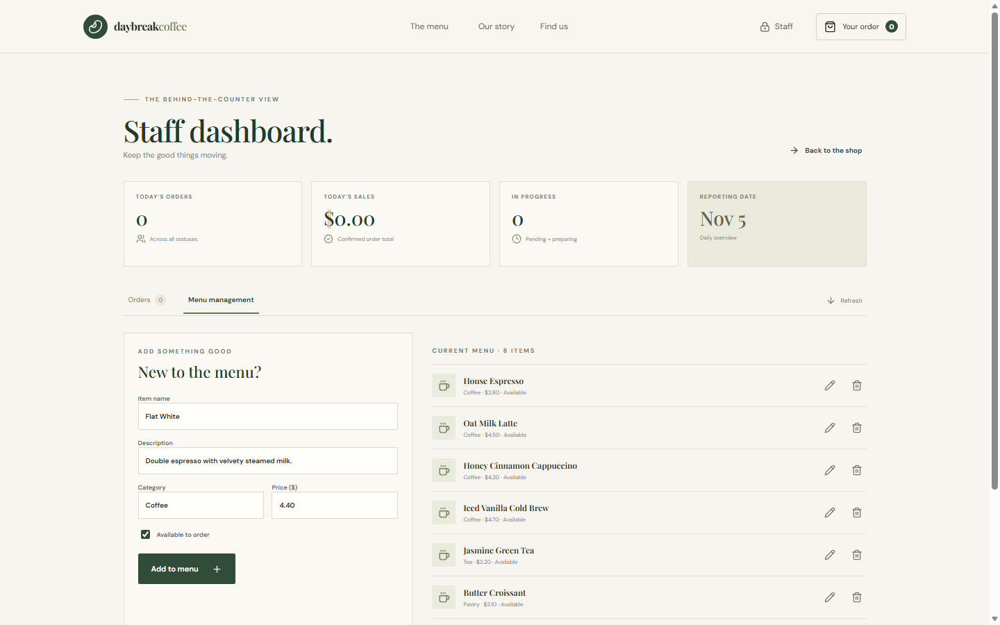
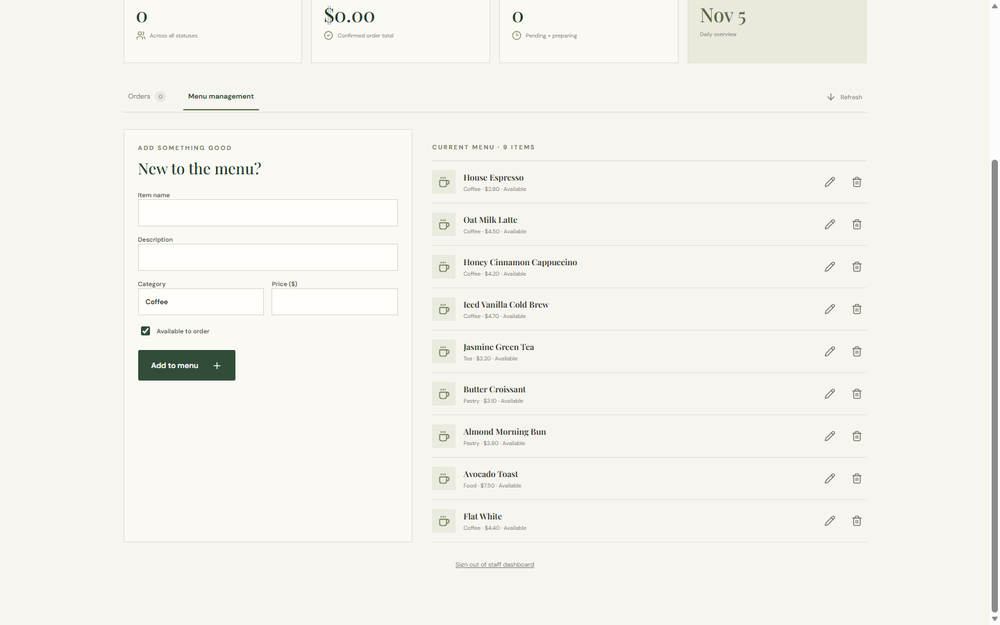
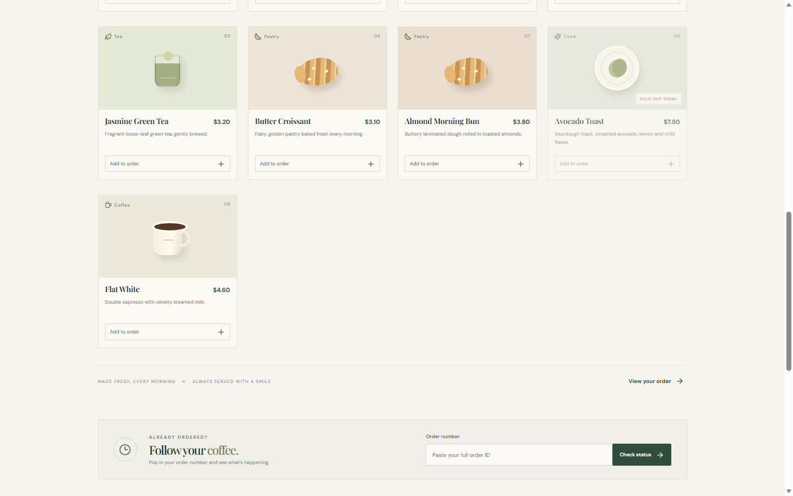
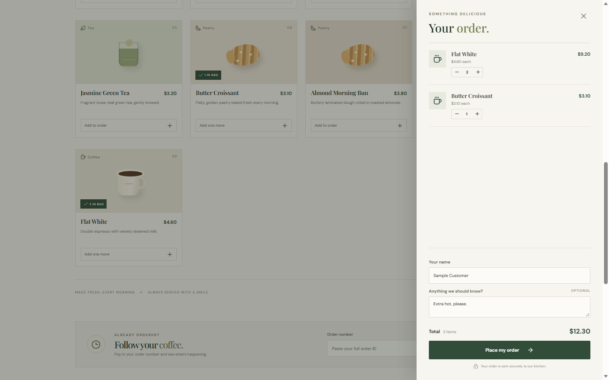
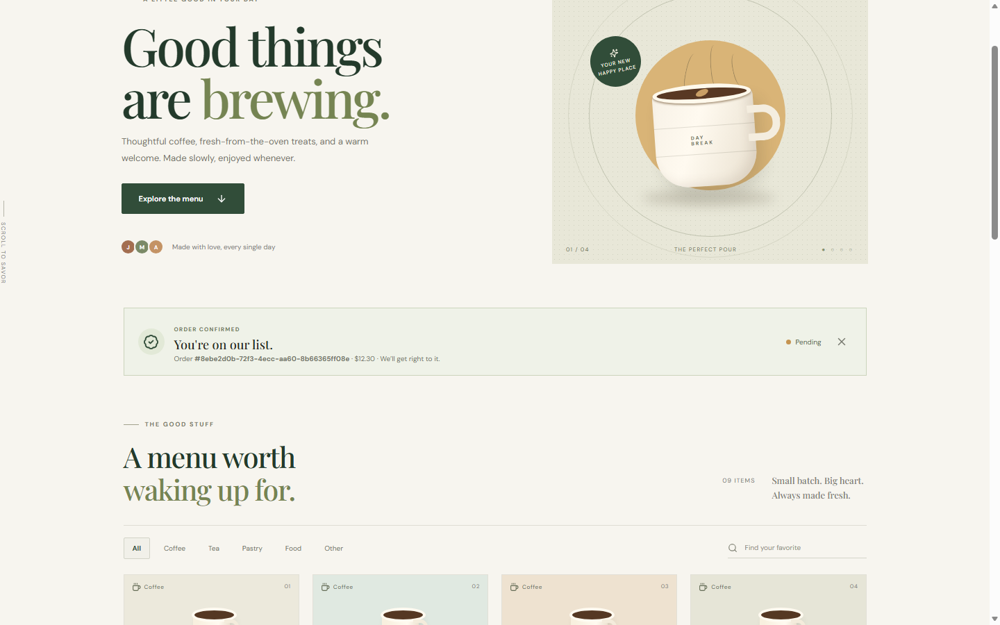
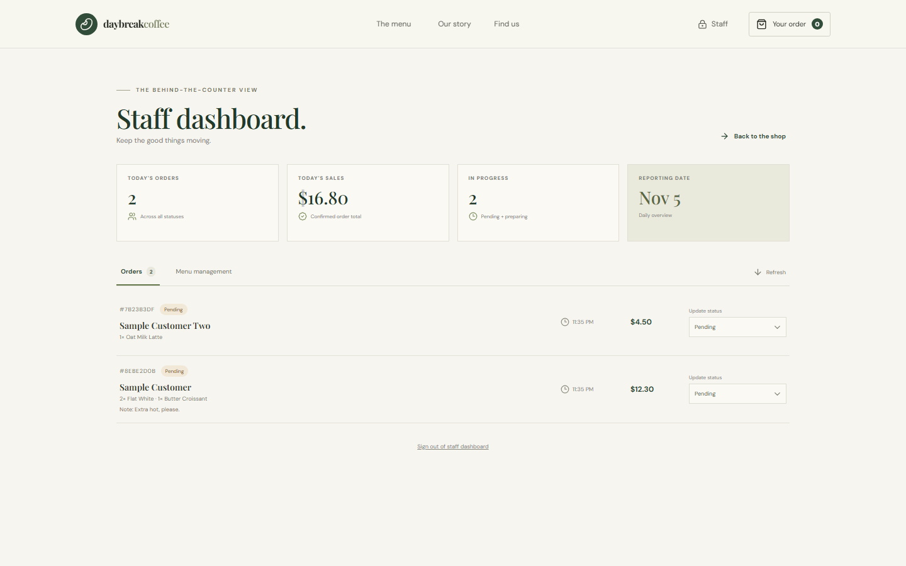
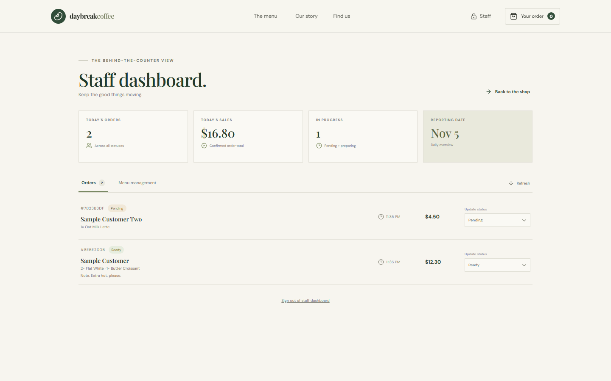
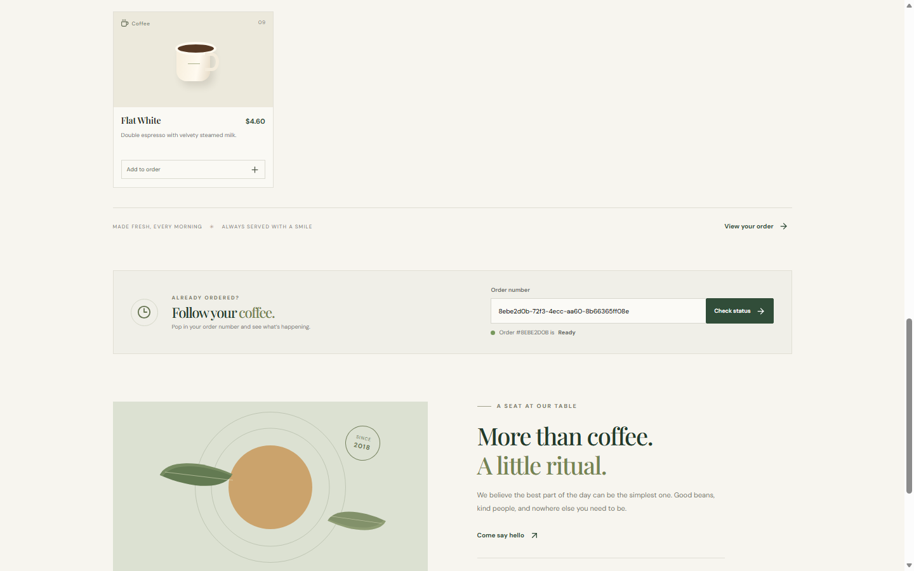

# Demonstration guide

This walks through the three actions the assignment asks to be demonstrated: adding a menu item, placing an order and updating its status. The screenshots use sample data from a local test run.

**Before you start:** open the backend's `/api/health` URL and wait for `"status":"ok"`, because the free Render service can take about a minute to wake up. Have the staff token ready.

## 1. Add a menu item (staff)

1. Open the website and select **Staff**.
2. Enter the staff token and select **Open dashboard**.
3. Open **Menu management**.
4. Fill in the name, description, category and price, then select **Add to menu**.

The new item appears in the current menu list. The browser sends `POST /api/menu`.

## 2. Place an order (customer)

1. Select **Back to the shop**. The new item is now on the customer menu.

   

2. Select **Add to order** on the new item and any other item.
3. Select **Your order**, and change a quantity with **+** or **-**.
4. Enter a name and optional note, then select **Place my order**.

   

5. The confirmation shows the unique order number. The browser sends `POST /api/orders`, and the server works out the total from stored prices.

   

## 3. Update the order status (staff)

1. Select **Staff**, open **Orders** and select **Refresh**. The order appears as Pending, with its items, note and total.

   

2. Change **Update status** to Preparing, then Ready. The browser sends `PATCH /api/orders/:id/status`.

   

3. Select **Back to the shop**, and enter the order number under **Follow your coffee**. The customer sees the new status.

   

## Optional: show that data persists

1. In the Render dashboard, select **Manual Deploy > Restart service** (or redeploy) and wait for it to come back.
2. Reload the website. The new menu item, the order and its status are all still there.
3. Show the stored records in the Upstash **Data Browser**, or run `npm run records` from the `server` folder.
